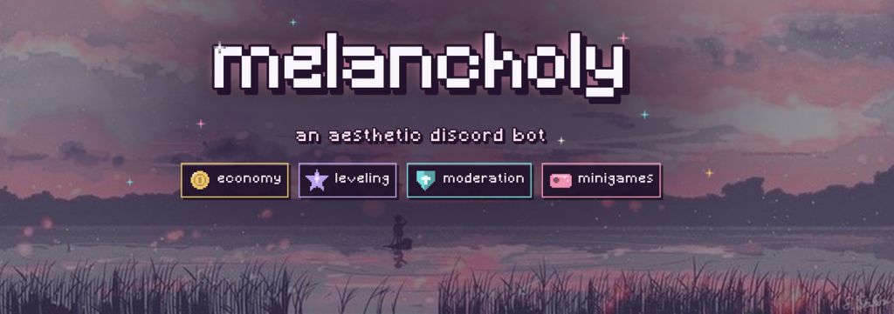

# Melancholy

Profiles, rewards, games, music, birthdays, and tools for Discord communities.

[Website](https://melancholy.fujiverse.dev/) · [Support server](https://discord.gg/elegy) · [Explore commands](COMMANDS.md)

Melancholy brings profiles, activity tracking, rewards, games, music stats, and birthdays into Discord. Members can find what they need through `/home` and `/help`. Server staff can configure moderation, logging, automation, roles, and other community tools.

This repository is Melancholy's public project display. It contains documentation, Melancholy's Discord banner, and one small source excerpt. The bot's application source, compiled files, credentials, and deployment configuration are private. There is no local installation package here.

## What members can do

| Area | Examples |
| --- | --- |
| Find their way | Open `/home` for personal shortcuts or search `/help find` by command name or goal. |
| Make a profile | Pixel-art profile and level cards, activity statistics, animated badges, and charm collections. |
| Earn and spend | Claim daily rewards, work, browse the shop shelves, use items, and check balances or cooldowns. |
| Follow a season | Complete daily, weekly, and seasonal Starlight quests and view ranks. |
| Celebrate birthdays | Save one birthday for every server, leave sealed wishes, and open them on the day for a gem gift. |
| Track music and games | Browse Last.fm, show what you're playing, and look up osu!, Chess.com, Lichess, Dota 2, and PUBG stats. |
| Have fun | Play `/games`, the minigame, trivia, social actions, and anime discovery. |
| Stay organized | Use reminders, AFK status, weather, timezones, and personal data controls. |

Melancholy supports slash commands, prefix commands using `!!`, and context menu actions. Some commands depend on server settings or Discord permissions. [Browse the command guide](COMMANDS.md) for starting points.

## Use it anywhere

Add Melancholy to your own account with **Add App → Add to my apps** to use `/game`, `/music`, `/anime`, `/weather`, `/image`, `/quote`, `/color`, `/font`, `/8ball`, `/ping`, `/changelogs`, `/avatar`, and `/birthday` in DMs, group chats, and servers Melancholy isn't in. Its icons are the bot's own application emojis, so they show up even where external emojis are turned off.

## What server staff can do

Configure welcome and verification flows, moderation and detailed audit logs, automated protections, role tools, birthday announcements and roles, custom occupations, and recurring role income. Melancholy also has server configuration snapshots and activity views. [Read the feature guide](FEATURES.md) for the fuller picture.

## A few details that matter

- Guild coins and account-wide gems have different scopes. Work rewards respect an activity cooldown across servers for gems.
- Starlight is seasonal progress. Its quests, divisions, and leaderboards are separate from spendable currency.
- Birthdays are kept once per account and start at midnight in each member's own timezone.
- `/data privacy`, `/data export`, and `/data delete` provide personal server data controls. Deletion covers eligible data, as explained in the command itself.
- Melancholy runs alongside other Elegy Apps bots on a shared private runtime. This repository covers Melancholy only.

## A look inside

[`src/events/ready/ready.ts`](src/events/ready/ready.ts) is a short excerpt of Melancholy's ready event. It shows how events are defined in the private runtime. It does not run on its own.

## Project notes

The current documented version is **v2.18**, matching the private application's version at the time this display was prepared. [Recent changes](CHANGELOG.md) summarize the public release history. For help or feedback, use the [support server](https://discord.gg/elegy) and see [support options](SUPPORT.md).

The source is private. [Notice](NOTICE.md) explains the scope of this repository. [Publishing notes](PUBLISHING.md) explain how to update these files without including the private project.
